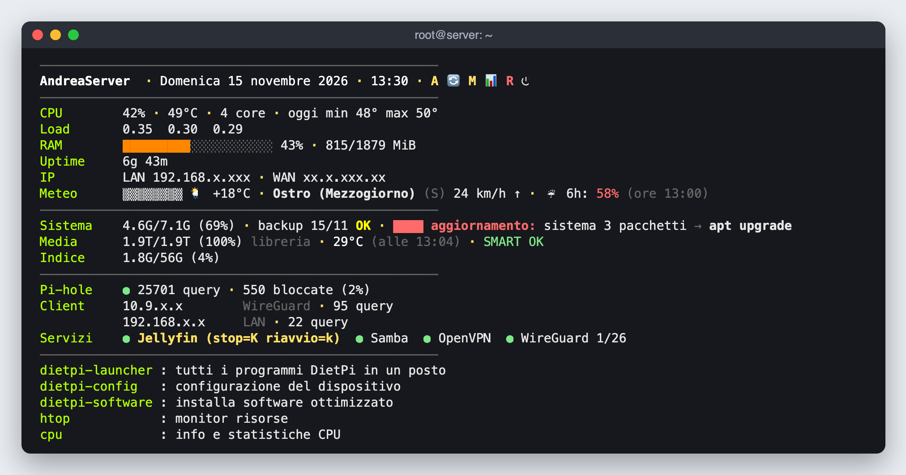
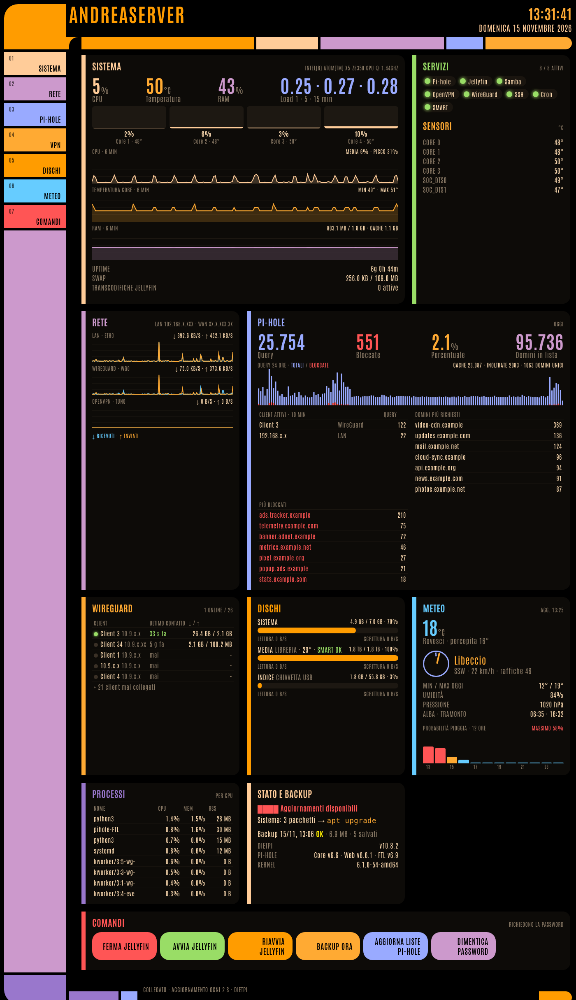
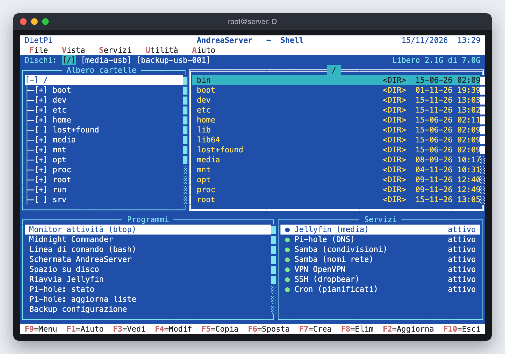
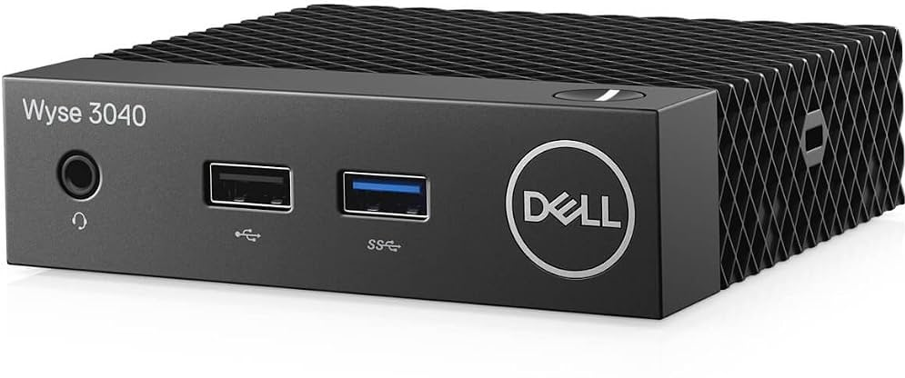

# AndreaServer

**A whole home server on a tiny, silent PC — set up with one command.**

🇬🇧 English · [🇮🇹 Italiano](docs/README.it.md) · [🇩🇪 Deutsch](docs/README.de.md) · [🇫🇷 Français](docs/README.fr.md) · [🇯🇵 日本語](docs/README.ja.md)

AndreaServer takes a cheap mini PC (a second-hand Dell Wyse 3040 thin client with an Atom CPU and 2 GB of RAM), a fresh [DietPi](https://dietpi.com) install and a couple of USB disks, and turns them into the little box in the corner that quietly looks after the whole house: no ads, your own Netflix, a shared drive, and a private tunnel home from anywhere.

It started as one real server, tuned over months. This repository is that server with everything personal taken out, so you can build your own.

```bash
bash <(curl -fsSL https://raw.githubusercontent.com/andreafis/andreaserver/main/bootstrap.sh) --lang en
```

## What it does for you

| | What you get | Powered by |
|---|---|---|
| 🚫 | **No more ads** on every phone, TV and laptop in the house, with nothing to install on them | Pi-hole |
| 🎬 | **Your own streaming service**: films, series and music from your disk, on any screen | Jellyfin |
| 📁 | **A shared folder** every computer on the network can open | Samba |
| 🔐 | **A private way home**: reach your files and films from a café or a hotel | WireGuard, OpenVPN |
| 📊 | **A live dashboard** in the browser, with charts and one-click buttons | web console |
| 👋 | **A status report** that greets you every time you log in | login banner |
| 🖱️ | **A retro point-and-click desktop** in the terminal, mouse included | text Shell |
| 💾 | **A weekly backup** of the whole configuration, kept automatically | `backup-server` |

## The nice little things

**It says hello.** Log in over SSH and, instead of a wall of text, you get a compact panel: uptime, CPU temperature, memory, your LAN and public IP, how full each disk is, when the last backup ran, how many ads Pi-hole has blocked today, and who is connected right now — labelled as LAN, WireGuard or OpenVPN.



**It knows the weather.** The banner and the dashboard show the forecast for your town, the chance of rain in the next six hours, and the wind called by its traditional Mediterranean name — *Tramontana*, *Scirocco*, *Maestrale* — instead of a compass bearing.

**A dashboard you can leave open on a tablet.** `http://your-server:8088` shows live charts for CPU, temperature, memory, network and disk activity, plus services, running processes, Pi-hole numbers and connected VPN clients. Password-protected buttons let you restart Jellyfin, refresh the blocklists or run a backup from your phone. It answers only to your home network and your VPN, uses nothing but Python's standard library, and is capped at 80 MB of memory.



**A 1991-style desktop over SSH.** Type `D` and the terminal becomes a windowed environment in the spirit of the old DOS file managers: a folder tree, a file list, a launcher for your programs and a live list of services. Click, double-click and scroll with the mouse; browse, view, edit, copy, move and delete files; start, stop and read the logs of a service — all without remembering a single command.



**One-letter commands**, for when you just want it done:

| Key | Does |
|---|---|
| `A` | show the status banner again |
| `D` | open the text Shell |
| `M` | activity monitor (btop) |
| `K` | stop Jellyfin (to let the disk sleep) |
| `k` | restart Jellyfin |
| `R` | emergency reboot, with a confirmation |

**It is kind to old hardware.** Logs live in RAM to spare the SD card or eMMC. The media disk's health is checked only when the disk is already awake, so it is never spun up just to be asked how it feels. Pi-hole keeps two days of history instead of three months.

**It backs itself up.** Every Sunday at 4 a.m. the configuration, the list of installed software and a Pi-hole export are packed into one archive on the second disk, with plain-language restore instructions inside. The last ten are kept.

*Screenshots are from the real server this project was born on. IP addresses, the town name and the Pi-hole domain lists have been masked.*

## The machine

<p align="center"></p>

<p align="center"><sub>Product photo © Dell Inc., shown for identification only; it is not covered by this project's license.</sub></p>

All of this runs on a **Dell Wyse 3040**, a palm-sized thin client that sells second-hand for the price of a pizza. It has no fan and no moving parts, so it is completely silent, and it sips so little power that it can stay on all year.

| | |
|---|---|
| Model | Dell Wyse 3040 thin client |
| Processor | Intel Atom x5-Z8350 · 4 cores · 1.44 GHz (burst 1.92 GHz) |
| Memory | 2 GB DDR3L 1600, soldered |
| Internal storage | 8 GB eMMC, soldered |
| Graphics | Intel HD Graphics 400 |
| Network | Gigabit Ethernet |
| Ports | 4 × USB (1 × USB 3), 2 × DisplayPort |
| Cooling | none: fanless, no moving parts |
| Power | 5 V / 3 A (15 W) adapter |
| Size and weight | about 10 × 10 × 3 cm, 240 g |
| System | DietPi 10.8 · Debian 12 · Linux 6.1 |

**How it copes, measured on the real server** with Pi-hole, Jellyfin, Samba, both VPNs and the dashboard all running:

- Memory in use: about 800 MB of 1.9 GB
- System disk: 4.6 GB used of 7.1 GB
- CPU temperature: around 49 °C, with no fan
- Running processes: about 120
- Cold boot to ready: about 50 seconds

Films and music live on a 2 TB USB hard disk, and backups go to a 64 GB USB stick, because the internal 8 GB holds only the system.

The honest limit: the Atom plays films in their original format without effort, but converting video on the fly (transcoding) is slow. Use players that can handle your files directly.

AndreaServer should run on any x86_64 machine supported by DietPi; this is simply the one it was built and tuned on.

## Install

1. Install [DietPi](https://dietpi.com) on the mini PC and finish its first boot.
2. Plug in your disks and mount them with `dietpi-drive_manager`.
3. As root, run the command at the top of this page.

A short wizard asks which disk holds your media, where backups should go, your town (for the weather), the name of the shared folder and a couple of passwords. DietPi may ask a few questions of its own while it installs the software, for example about the VPNs.

The wizard speaks **English, Italian, German, French and Japanese**. For an unattended install, copy `andreaserver.conf.example`, fill it in and run `./install.sh --config my.conf`.

## Nothing personal inside

This repository contains no keys, passwords, tokens, home addresses or personal data. VPN keys, certificates and passwords are generated fresh on every machine; everything specific to your home is asked during setup and stored only in `/etc/andreaserver/andreaserver.conf` on your server. `tools/check-secrets.sh` scans the repository before every publish.

## Honest notes

- **Not yet tested on a clean machine.** It was derived from a working x86_64 server running DietPi 10 (Debian 12). Expect rough edges on the first installs, and please open an issue when you find one.
- **DietPi is required.** On plain Debian the installer stops.
- **The banner, dashboard and Shell are in Italian for now.** The installer and the documentation are translated.
- **The shared folder can be opened without a password** if you choose so during setup. That is fine on a home network you trust, and nowhere else.
- To refresh AndreaServer's files after a `git pull`: `/opt/andreaserver/install.sh --files-only`.

## License

[MIT](LICENSE)
