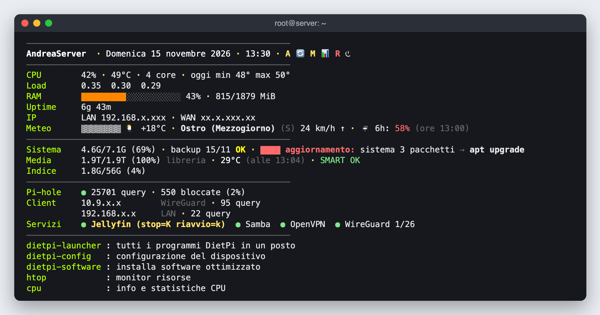
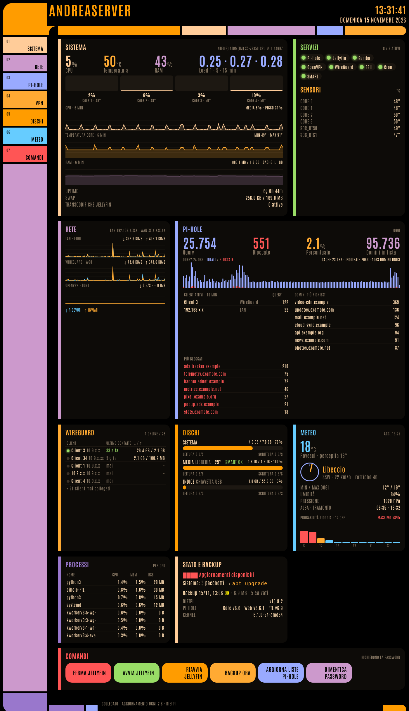
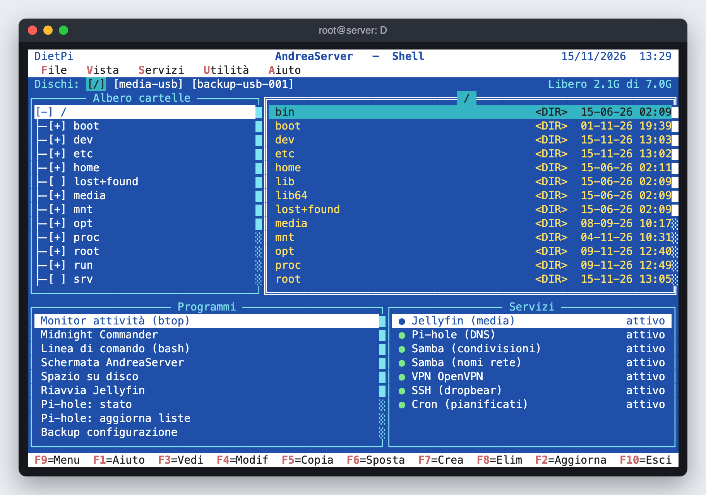
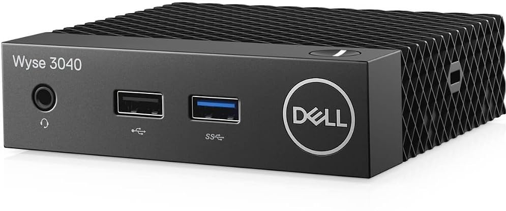

# AndreaServer

**Der kleine Heimserver.** AndreaServer macht aus einem Mini-PC mit DietPi mit einem einzigen Befehl einen vollständigen Heimserver.

[🇮🇹 Italiano](README.it.md) · [🇬🇧 English](../README.md) · 🇩🇪 Deutsch · [🇫🇷 Français](README.fr.md) · [🇯🇵 日本語](README.ja.md)

## Was installiert wird

| Was | Wozu | Wo |
|---|---|---|
| Pi-hole | blockiert Werbung im gesamten Netzwerk | `http://IP/admin` |
| Jellyfin | Filme und Musik auf TV, Handy, Browser | `http://IP:8096` |
| Samba | freigegebener Netzwerkordner | `\\IP\Media` |
| WireGuard und OpenVPN | Zugriff von unterwegs | `dietpi-software` |
| Web-Konsole | Serverstatus, Diagramme, Schaltflächen | `http://IP:8088` |
| Banner | Serverübersicht bei jeder Anmeldung | beim Login |
| Text-Shell | Fenster, Menüs und Maus im Terminal | Befehl `D` |

Kurzbefehle: `A` Banner · `D` Shell · `M` Monitor · `K` Jellyfin stoppen · `k` Jellyfin neu starten · `R` Neustart · `backup-server` Sicherung der Konfiguration.







*Bilder vom echten Server, aus dem dieses Projekt entstanden ist. IP-Adressen, Ortsname und die Pi-hole-Domainlisten wurden unkenntlich gemacht.*

## Die Maschine

<p align="center"></p>

<p align="center"><sub>Produktfoto © Dell Inc., nur zur Identifizierung gezeigt; es fällt nicht unter die Lizenz dieses Projekts.</sub></p>

All das läuft auf einem **Dell Wyse 3040**, einem handtellergroßen Thin Client, der gebraucht so viel kostet wie eine Pizza. Er hat keinen Lüfter und keine beweglichen Teile, ist also völlig lautlos, und verbraucht so wenig Strom, dass er das ganze Jahr laufen kann.

| | |
|---|---|
| Modell | Dell Wyse 3040 thin client |
| Prozessor | Intel Atom x5-Z8350 · 4 cores · 1.44 GHz (burst 1.92 GHz) |
| Arbeitsspeicher | 2 GB DDR3L 1600, soldered |
| Interner Speicher | 8 GB eMMC, soldered |
| Grafik | Intel HD Graphics 400 |
| Netzwerk | Gigabit Ethernet |
| Anschlüsse | 4 × USB (1 × USB 3), 2 × DisplayPort |
| Kühlung | keine: lüfterlos, keine beweglichen Teile |
| Stromversorgung | 5 V / 3 A (15 W) Netzteil |
| Größe und Gewicht | about 10 × 10 × 3 cm, 240 g |
| System | DietPi 10.8 · Debian 12 · Linux 6.1 |

**Wie er sich schlägt, gemessen am echten Server** mit Pi-hole, Jellyfin, Samba, beiden VPNs und der Konsole in Betrieb:

- Belegter Arbeitsspeicher: etwa 800 MB von 1,9 GB
- Systemlaufwerk: 4,6 GB von 7,1 GB belegt
- CPU-Temperatur: rund 49 °C, ohne Lüfter
- Laufende Prozesse: etwa 120
- Kaltstart bis betriebsbereit: etwa 50 Sekunden

Filme und Musik liegen auf einer 2-TB-USB-Festplatte, Backups auf einem 64-GB-USB-Stick, denn die internen 8 GB reichen nur für das System.

Die ehrliche Grenze: Der Atom spielt Filme im Originalformat mühelos ab, aber das Umwandeln von Video in Echtzeit (Transcoding) ist langsam. Nutze Player, die deine Dateien direkt abspielen können.

AndreaServer sollte auf jedem von DietPi unterstützten x86_64-Rechner laufen; dies ist einfach der, auf dem es entstanden ist.

## Installation

1. [DietPi](https://dietpi.com) (Debian) auf dem Mini-PC installieren und den ersten Start abschließen.
2. Externe Festplatten anschließen und mit `dietpi-drive_manager` einhängen.
3. Als root:

```bash
bash <(curl -fsSL https://raw.githubusercontent.com/andreafis/andreaserver/main/bootstrap.sh) --lang de
```

Die Einrichtung fragt nach Sprache, Festplatten, Stadt für das Wetter, Name der Freigabe und Passwörtern. Während der Installation der Programme stellt DietPi eventuell ein paar Fragen (zum Beispiel zu den VPNs).

Ohne Fragen: `andreaserver.conf.example` kopieren, ausfüllen und `./install.sh --config meine.conf` starten.

## Was NICHT enthalten ist

Das Repository enthält keine Schlüssel, Passwörter, Tokens, Heimadressen oder persönlichen Daten. VPN-Schlüssel, Passwörter und Zertifikate werden auf jedem Rechner neu erzeugt. Die lokale Konfiguration liegt in `/etc/andreaserver/andreaserver.conf` und darf nicht veröffentlicht werden. Vor jeder Veröffentlichung: `tools/check-secrets.sh`.

## Gut zu wissen

- Abgeleitet von einem x86_64-Server mit DietPi 10 (Debian 12). Der Installer wurde noch nicht auf einem frischen Rechner getestet. DietPi ist erforderlich: Auf reinem Debian bricht der Installer ab.
- Die Freigabe kann ohne Passwort geöffnet werden (Auswahl bei der Einrichtung): nur für ein vertrauenswürdiges Heimnetz geeignet.
- Banner, Web-Konsole und Shell gibt es vorerst nur auf Italienisch; Installer und Dokumentation liegen in fünf Sprachen vor.
- AndreaServer-Dateien nach einem `git pull` aktualisieren: `/opt/andreaserver/install.sh --files-only`.

## Lizenz

[MIT](../LICENSE)
