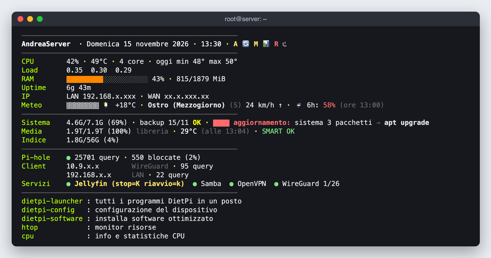
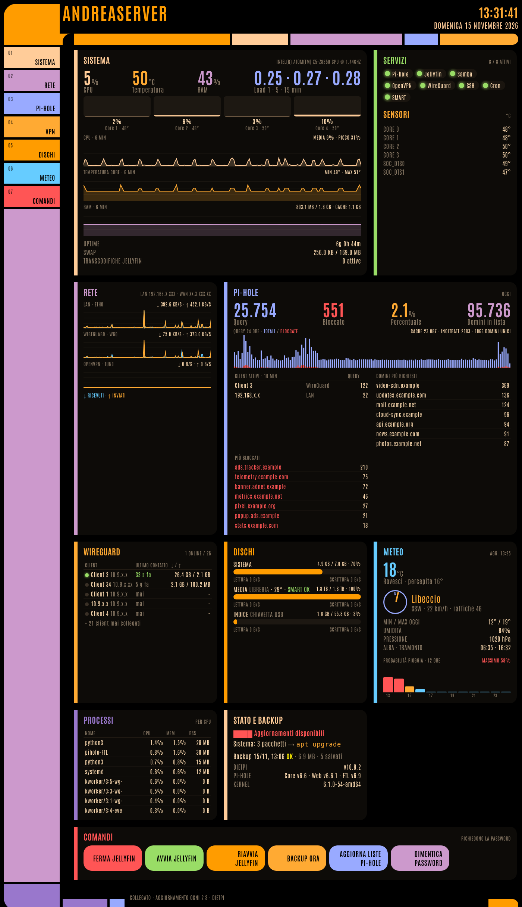
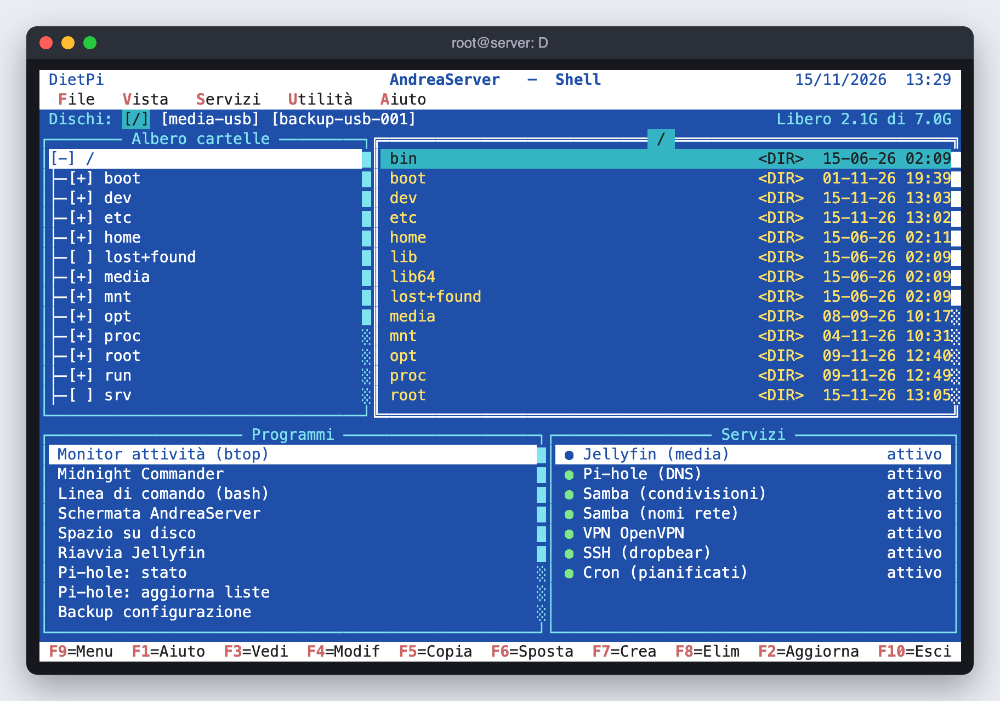

# AndreaServer

**Le petit serveur de la maison.** AndreaServer transforme un mini PC sous DietPi en serveur domestique complet, en une seule commande.

[🇮🇹 Italiano](README.it.md) · [🇬🇧 English](../README.md) · [🇩🇪 Deutsch](README.de.md) · 🇫🇷 Français · [🇯🇵 日本語](README.ja.md)

## Ce qui est installé

| Quoi | À quoi ça sert | Où |
|---|---|---|
| Pi-hole | bloque la publicité sur tout le réseau | `http://IP/admin` |
| Jellyfin | films et musique sur TV, téléphone, navigateur | `http://IP:8096` |
| Samba | dossier partagé sur le réseau | `\\IP\Media` |
| WireGuard et OpenVPN | accès à la maison depuis l'extérieur | `dietpi-software` |
| Console web | état du serveur, graphiques, boutons | `http://IP:8088` |
| Bannière | résumé du serveur à chaque connexion | à la connexion |
| Shell texte | fenêtres, menus et souris dans le terminal | commande `D` |

Commandes rapides : `A` bannière · `D` Shell · `M` moniteur · `K` arrêter Jellyfin · `k` redémarrer Jellyfin · `R` redémarrage · `backup-server` sauvegarde de la configuration.







*Captures du vrai serveur dont ce projet est issu. Les adresses IP, le nom de la ville et les listes de domaines Pi-hole ont été masqués.*

## La machine

Tout cela tourne sur un **Dell Wyse 3040**, un client léger qui tient dans la paume et se trouve d'occasion pour le prix d'une pizza. Il n'a ni ventilateur ni pièce mobile : il est donc totalement silencieux, et consomme si peu qu'il peut rester allumé toute l'année.

| | |
|---|---|
| Modèle | Dell Wyse 3040 thin client |
| Processeur | Intel Atom x5-Z8350 · 4 cores · 1.44 GHz (burst 1.92 GHz) |
| Mémoire | 2 GB DDR3L 1600, soldered |
| Stockage interne | 8 GB eMMC, soldered |
| Graphique | Intel HD Graphics 400 |
| Réseau | Gigabit Ethernet |
| Ports | 4 × USB (1 × USB 3), 2 × DisplayPort |
| Refroidissement | aucun : sans ventilateur, aucune pièce mobile |
| Alimentation | 5 V / 3 A (15 W) adaptateur |
| Taille et poids | about 10 × 10 × 3 cm, 240 g |
| Système | DietPi 10.8 · Debian 12 · Linux 6.1 |

**Comment il s'en sort, mesuré sur le vrai serveur** avec Pi-hole, Jellyfin, Samba, les deux VPN et la console en service :

- Mémoire utilisée : environ 800 Mo sur 1,9 Go
- Disque système : 4,6 Go utilisés sur 7,1 Go
- Température du processeur : autour de 49 °C, sans ventilateur
- Processus actifs : environ 120
- Démarrage à froid : environ 50 secondes

Les films et la musique sont sur un disque USB de 2 To et les sauvegardes sur une clé USB de 64 Go, car les 8 Go internes ne suffisent que pour le système.

La limite, dite franchement : l'Atom lit les films dans leur format d'origine sans effort, mais la conversion vidéo à la volée (transcodage) est lente. Utilisez des lecteurs capables d'ouvrir directement vos fichiers.

AndreaServer devrait fonctionner sur toute machine x86_64 prise en charge par DietPi ; celle-ci est simplement celle sur laquelle il est né.

## Installation

1. Installez [DietPi](https://dietpi.com) (Debian) sur le mini PC et terminez le premier démarrage.
2. Branchez et montez les disques externes avec `dietpi-drive_manager`.
3. En root :

```bash
bash <(curl -fsSL https://raw.githubusercontent.com/andreafis/andreaserver/main/bootstrap.sh) --lang fr
```

L'installation demande la langue, les disques, la ville pour la météo, le nom du dossier partagé et les mots de passe. Pendant l'installation des programmes, DietPi peut poser quelques questions (par exemple pour les VPN).

Sans questions : copiez `andreaserver.conf.example`, remplissez-le et lancez `./install.sh --config ma.conf`.

## Ce qu'il ne contient PAS

Le dépôt ne contient ni clés, ni mots de passe, ni jetons, ni adresses du domicile, ni données personnelles. Les clés VPN, mots de passe et certificats sont créés à neuf sur chaque machine. La configuration locale se trouve dans `/etc/andreaserver/andreaserver.conf` et ne doit pas être publiée. Avant chaque publication : `tools/check-secrets.sh`.

## À savoir

- Dérivé d'un serveur x86_64 sous DietPi 10 (Debian 12). L'installateur n'a pas encore été testé sur une machine vierge. DietPi est requis : sur une Debian nue, l'installateur s'arrête.
- Le dossier partagé peut être ouvert sans mot de passe (choix à l'installation) : à réserver à un réseau domestique de confiance.
- La bannière, la console web et le Shell sont pour l'instant en italien ; l'installateur et la documentation existent en cinq langues.
- Mettre à jour les fichiers de AndreaServer après un `git pull` : `/opt/andreaserver/install.sh --files-only`.

## Licence

[MIT](../LICENSE)
