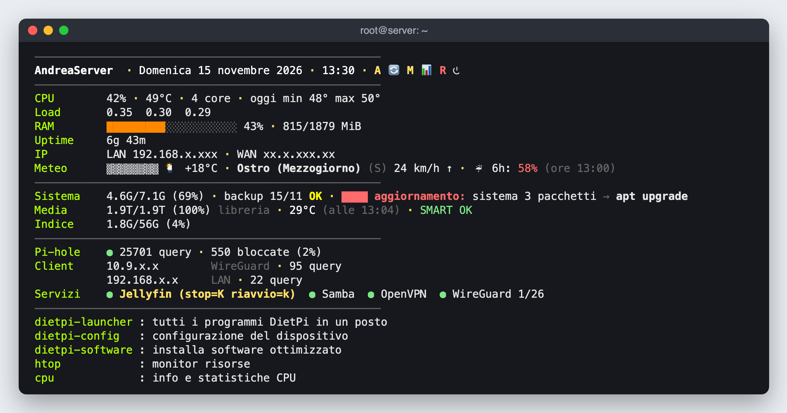
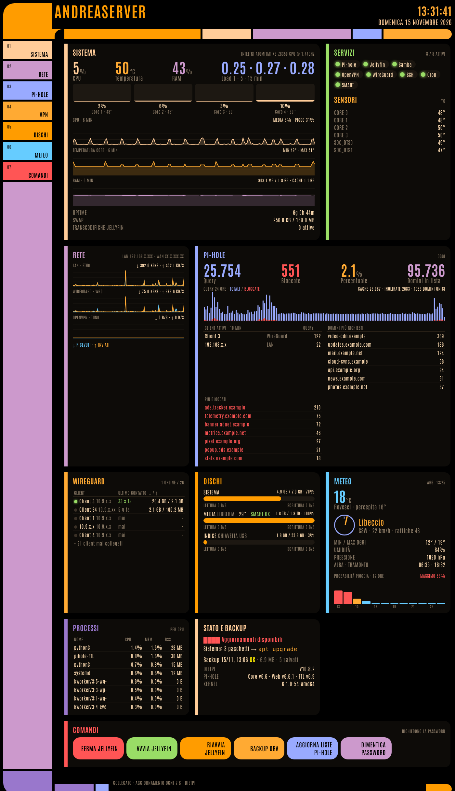
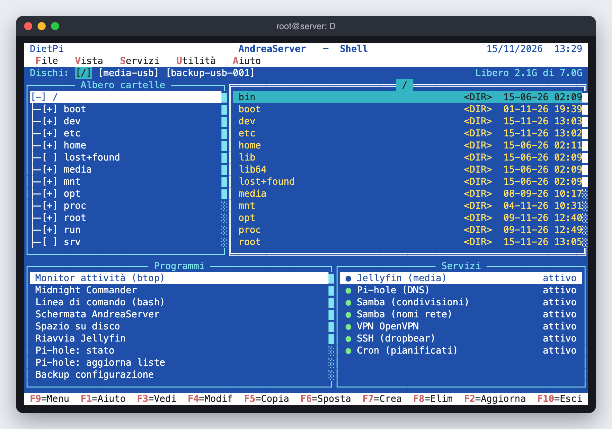
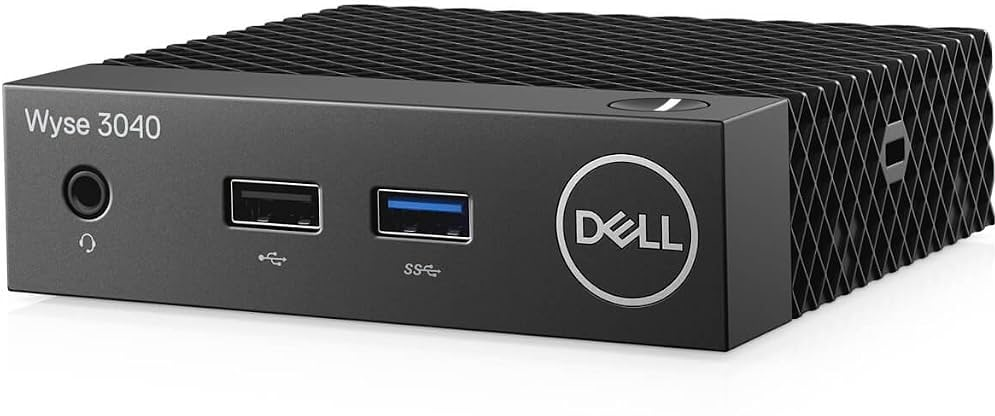

# AndreaServer

**Il piccolo server di casa.** AndreaServer trasforma un mini PC con DietPi in un server domestico completo con un solo comando.

🇮🇹 Italiano · [🇬🇧 English](../README.md) · [🇩🇪 Deutsch](README.de.md) · [🇫🇷 Français](README.fr.md) · [🇯🇵 日本語](README.ja.md)

## Cosa installa

| Cosa | A cosa serve | Dove |
|---|---|---|
| Pi-hole | blocca la pubblicità su tutta la rete | `http://IP/admin` |
| Jellyfin | film e musica su TV, telefono, browser | `http://IP:8096` |
| Samba | cartella condivisa in rete | `\\IP\Media` |
| WireGuard e OpenVPN | accesso a casa da fuori | `dietpi-software` |
| Console web | stato del server, grafici, pulsanti | `http://IP:8088` |
| Banner | riepilogo del server a ogni accesso | al login |
| Shell testuale | finestre, menu e mouse nel terminale | comando `D` |

Comandi rapidi: `A` banner · `D` Shell · `M` monitor · `K` ferma Jellyfin · `k` riavvia Jellyfin · `R` riavvio · `backup-server` backup della configurazione.







*Immagini dal server vero da cui nasce il progetto. Indirizzi IP, nome della città ed elenchi dei domini di Pi-hole sono stati mascherati.*

## La macchina

<p align="center"></p>

<p align="center"><sub>Foto del prodotto © Dell Inc., mostrata solo per identificare la macchina; non rientra nella licenza di questo progetto.</sub></p>

Tutto questo gira su un **Dell Wyse 3040**, un thin client grande come un palmo che usato costa quanto una pizza. Non ha ventola né parti in movimento, quindi è completamente silenzioso, e consuma così poco che può restare acceso tutto l'anno.

| | |
|---|---|
| Modello | Dell Wyse 3040 thin client |
| Processore | Intel Atom x5-Z8350 · 4 cores · 1.44 GHz (burst 1.92 GHz) |
| Memoria | 2 GB DDR3L 1600, soldered |
| Disco interno | 8 GB eMMC, soldered |
| Grafica | Intel HD Graphics 400 |
| Rete | Gigabit Ethernet |
| Porte | 4 × USB (1 × USB 3), 2 × DisplayPort |
| Raffreddamento | nessuno: senza ventola, nessuna parte in movimento |
| Alimentazione | 5 V / 3 A (15 W) alimentatore |
| Dimensioni e peso | about 10 × 10 × 3 cm, 240 g |
| Sistema | DietPi 10.8 · Debian 12 · Linux 6.1 |

**Come se la cava, misurato sul server vero** con Pi-hole, Jellyfin, Samba, le due VPN e la console tutti accesi:

- Memoria in uso: circa 800 MB su 1,9 GB
- Disco di sistema: 4,6 GB usati su 7,1 GB
- Temperatura CPU: intorno a 49 °C, senza ventola
- Processi attivi: circa 120
- Avvio da spento a pronto: circa 50 secondi

Film e musica stanno su un disco USB da 2 TB e i backup su una chiavetta USB da 64 GB, perché gli 8 GB interni bastano solo per il sistema.

Il limite, detto chiaramente: l'Atom riproduce i film nel formato originale senza fatica, ma convertire il video al volo (transcodifica) è lento. Usa lettori che sappiano aprire direttamente i tuoi file.

AndreaServer dovrebbe funzionare su qualsiasi macchina x86_64 supportata da DietPi; questa è semplicemente quella su cui è nato.

## Installazione

1. Installa [DietPi](https://dietpi.com) (Debian) sul mini PC e completa il primo avvio.
2. Collega e monta i dischi esterni con `dietpi-drive_manager`.
3. Da root:

```bash
bash <(curl -fsSL https://raw.githubusercontent.com/andreafis/andreaserver/main/bootstrap.sh)
```

La procedura chiede lingua, dischi, città per il meteo, nome della cartella condivisa e password. Durante l'installazione dei programmi DietPi può fare qualche domanda (per esempio per le VPN).

Senza domande: copia `andreaserver.conf.example`, compilalo e lancia `./install.sh --config mio.conf`.

## Cosa NON contiene

Nel repository non ci sono chiavi, password, token, indirizzi di casa né dati personali. Chiavi VPN, password e certificati vengono creati nuovi su ogni macchina. La configurazione locale sta in `/etc/andreaserver/andreaserver.conf` e non va pubblicata. Prima di ogni pubblicazione: `tools/check-secrets.sh`.

## Da sapere

- Ricavato da un server x86_64 con DietPi 10 (Debian 12). L'installatore non è ancora stato provato su una macchina pulita. Serve DietPi: su Debian puro l'installatore si ferma.
- La cartella condivisa può essere aperta senza password (scelta durante l'installazione): va bene solo su una rete di casa fidata.
- Banner, console web e Shell sono per ora in italiano; installatore e documentazione sono in cinque lingue.
- Aggiornare i file di AndreaServer dopo un `git pull`: `/opt/andreaserver/install.sh --files-only`.

## Licenza

[MIT](../LICENSE)
