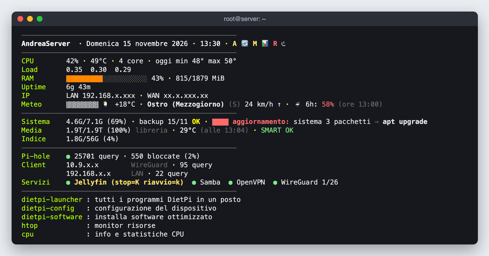
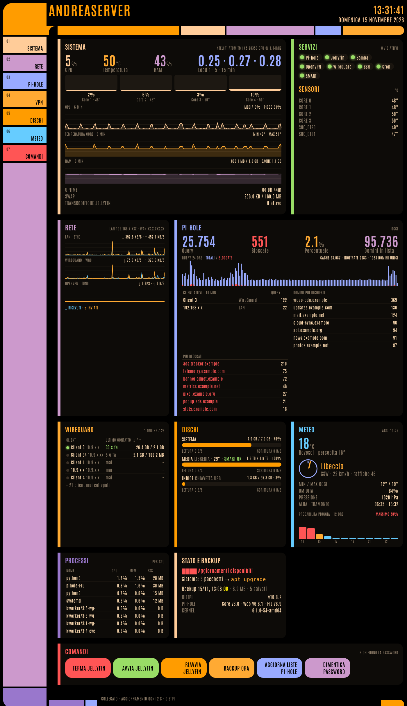
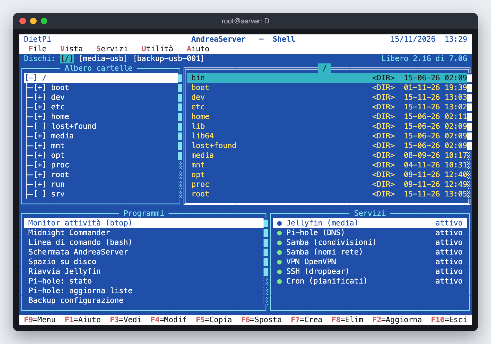

# AndreaServer

**小さなホームサーバー。** AndreaServer は、DietPi を入れたミニ PC をコマンドひとつで本格的なホームサーバーに変えます。

[🇮🇹 Italiano](README.it.md) · [🇬🇧 English](../README.md) · [🇩🇪 Deutsch](README.de.md) · [🇫🇷 Français](README.fr.md) · 🇯🇵 日本語

## インストールされるもの

| 名前 | 役割 | 場所 |
|---|---|---|
| Pi-hole | ネットワーク全体の広告をブロック | `http://IP/admin` |
| Jellyfin | 映画や音楽をテレビ・スマホ・ブラウザーで再生 | `http://IP:8096` |
| Samba | ネットワーク共有フォルダー | `\\IP\Media` |
| WireGuard / OpenVPN | 外出先から自宅に接続 | `dietpi-software` |
| ウェブコンソール | サーバーの状態、グラフ、操作ボタン | `http://IP:8088` |
| バナー | ログインのたびにサーバーの概要を表示 | ログイン時 |
| テキスト Shell | ターミナル上のウィンドウ、メニュー、マウス操作 | コマンド `D` |

ショートカット: `A` バナー · `D` Shell · `M` モニター · `K` Jellyfin 停止 · `k` Jellyfin 再起動 · `R` 再起動 · `backup-server` 設定のバックアップ。







*このプロジェクトのもとになった実際のサーバーの画面です。IP アドレス、都市名、Pi-hole のドメイン一覧は伏せてあります。*

## マシンについて

これらはすべて **Dell Wyse 3040** で動いています。手のひらサイズのシンクライアントで、中古ならピザ 1 枚ほどの値段で手に入ります。ファンも可動部品もないので完全に無音で、消費電力もごくわずか。一年中つけっぱなしにできます。

| | |
|---|---|
| モデル | Dell Wyse 3040 thin client |
| プロセッサー | Intel Atom x5-Z8350 · 4 cores · 1.44 GHz (burst 1.92 GHz) |
| メモリー | 2 GB DDR3L 1600, soldered |
| 内蔵ストレージ | 8 GB eMMC, soldered |
| グラフィックス | Intel HD Graphics 400 |
| ネットワーク | Gigabit Ethernet |
| ポート | 4 × USB (1 × USB 3), 2 × DisplayPort |
| 冷却 | なし（ファンレス、可動部品なし） |
| 電源 | 5 V / 3 A (15 W) アダプター |
| サイズと重さ | about 10 × 10 × 3 cm, 240 g |
| システム | DietPi 10.8 · Debian 12 · Linux 6.1 |

**実際のサーバーでの実測値**（Pi-hole、Jellyfin、Samba、2 つの VPN、コンソールをすべて動かした状態）：

- メモリー使用量: 1.9 GB 中 約 800 MB
- システムディスク: 7.1 GB 中 4.6 GB 使用
- CPU 温度: ファンなしで約 49 °C
- 実行中のプロセス: 約 120
- 電源オンから利用可能まで: 約 50 秒

映画や音楽は 2 TB の USB ハードディスクに、バックアップは 64 GB の USB メモリーに置いています。内蔵の 8 GB はシステムだけでいっぱいになるためです。

正直な限界: Atom は元の形式のままなら映画を楽に再生できますが、その場で動画を変換する処理（トランスコード）は遅くなります。ファイルをそのまま再生できるプレーヤーを使ってください。

AndreaServer は DietPi が対応する x86_64 マシンならどれでも動くはずです。このマシンは、たまたま開発と調整に使ったものです。

## インストール

1. ミニ PC に [DietPi](https://dietpi.com)（Debian）をインストールし、初回起動を完了します。
2. 外付けディスクを接続し、`dietpi-drive_manager` でマウントします。
3. root で実行します。

```bash
bash <(curl -fsSL https://raw.githubusercontent.com/andreafis/andreaserver/main/bootstrap.sh) --lang ja
```

セットアップでは、言語、ディスク、天気を表示する都市、共有フォルダー名、パスワードを尋ねます。ソフトウェアのインストール中に DietPi からいくつか質問されることがあります（VPN の設定など）。

質問なしで実行する場合: `andreaserver.conf.example` をコピーして記入し、`./install.sh --config my.conf` を実行します。

## 含まれていないもの

このリポジトリには、鍵、パスワード、トークン、自宅のアドレス、個人データは一切含まれていません。VPN の鍵、パスワード、証明書はマシンごとに新しく作成されます。ローカル設定は `/etc/andreaserver/andreaserver.conf` にあり、公開してはいけません。公開の前には必ず `tools/check-secrets.sh` を実行してください。

## 知っておくこと

- DietPi 10（Debian 12）の x86_64 サーバーをもとに作成しました。インストーラーはまだ新規のマシンでは試していません。DietPi が必須で、素の Debian ではインストーラーは停止します。
- 共有フォルダーはパスワードなしで開けるようにできます（セットアップ時に選択）。信頼できる家庭内ネットワークでのみ使ってください。
- バナー、ウェブコンソール、Shell は今のところイタリア語のみです。インストーラーとドキュメントは 5 言語に対応しています。
- 日本語の画面は SSH 接続のターミナルで表示してください。本体に直接つないだ画面では文字化けします。
- `git pull` のあとに AndreaServer のファイルを更新するには: `/opt/andreaserver/install.sh --files-only`

## ライセンス

[MIT](../LICENSE)
